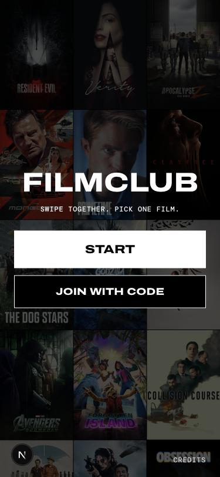
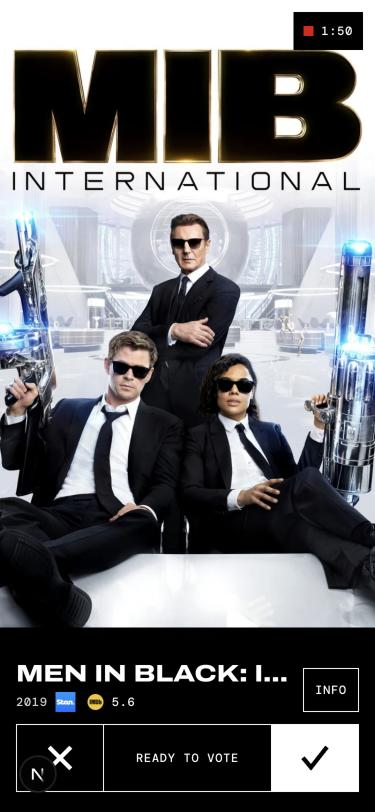
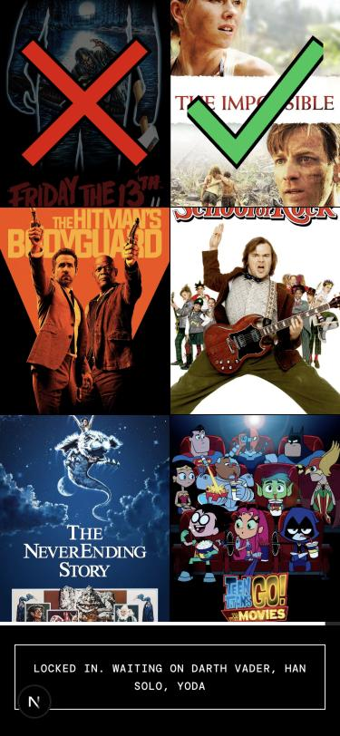

# Filmclub

Swipe together. Pick one film.

Filmclub solves one small, familiar problem: a group on a couch who can't agree on what to watch. Everyone swipes posters on their own phone, with no accounts. A film everyone likes wins instantly. If nothing matches, a fast cross-and-tick vote narrows the group's favourites to one, usually within a few minutes.

On your own? Press Test it and three labelled bots join, so you can see the whole round.

  
  
  

## How a round works

1. The host picks streaming services and shares a four-letter code.
2. Everyone gets a nickname from one shared story and their own opening films.
3. A film one person likes spreads to the others. A film anyone rejects leaves the other decks, because it can no longer be unanimous.
4. Unanimous likes end the round. Otherwise, everyone readies up or the two-minute clock runs out.
5. Each person crosses one film and ticks one. Crossed films go, ticked survivors continue, and ties go to the randomiser.

## The interesting engineering

**A deck that can't glitch.** Earlier versions edited each person's card list as realtime events arrived, so fast or simultaneous swipes made cards vanish and stutter. The deck is now a pure calculation over swipe facts. Each fact is safe to repeat and safe in any order, and the first four cards are frozen, so nothing that happens elsewhere can move a card someone can see. A simulator plays thousands of swipes with late, repeated and out-of-order events to prove it. See [ALGORITHMS.md](ALGORITHMS.md).

**Race-free results.** A database trigger locks the session row, so two people landing the last like together can't both miss the match. Server transitions are conditional updates, so any client can trigger one and only one call wins.

**Security without sign-up.** Everyone gets an invisible anonymous login. Database rules let the browser read only its own session and write only its own swipes, and everything else goes through one validated, rate-limited server route. `tests/security.test.ts` tries to break those rules as a real user.

**One tunable place.** Genre taste, franchise blocking, like spreading and more are plain rules in `DECK_RULES`, so the deck can change without touching the interface.

## Built with

Next.js, TypeScript, Supabase (Postgres, realtime, anonymous auth), Upstash, Framer Motion, Tailwind CSS, Vitest, TMDB and OMDb.

Built with Claude Code as a development tool. Product direction, design decisions and testing are mine.

## Run it

See [SETUP.md](SETUP.md).

This product uses the TMDB API but is not endorsed or certified by TMDB. Streaming data from JustWatch.
